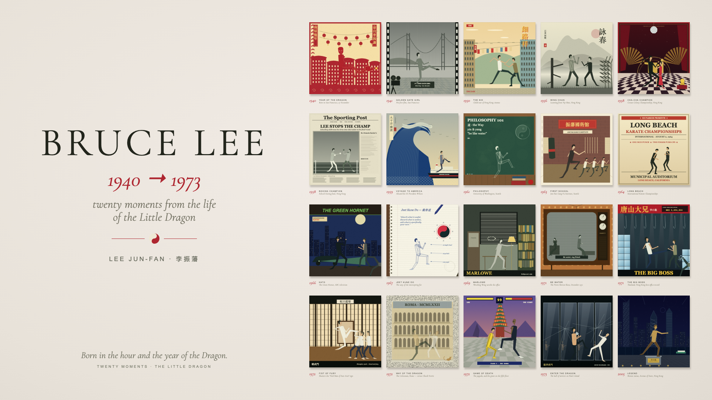

# Bruce Lee — The Little Dragon

Twenty animated moments from Bruce Lee’s life, implemented in React, TypeScript and Canvas 2D. The supplied recording is a visual reference for our own drawing and choreography.

```sh
npm ci
npm run dev
```

The development session is available at [localhost:5174](http://localhost:5174/).

All twenty illustrations, characters, props and foreground effects are drawn by code. Each scene has its own joint targets, movement track, supporting actors and reactions. Poses interpolate continuously at the playback timestamp. There are no extracted video frames, image atlases or animation chunks in the application. The soundtrack is the original extracted audio.

Static backgrounds are drawn into bounded Canvas caches at the displayed physical resolution, including Retina. Characters render directly at that resolution. The mosaic samples our own procedurally drawn actors to create individual tiles.

**This is an editable native reconstruction, still visibly different from the original.** Character anatomy, background details and choreography require further visual refinement for 1:1 parity. See [visual review](docs/VISUAL_REVIEW.md).



## Controls

- Play / Pause, Replay, Overview, Sound and timeline.
- Click a poster or choose a work in the accessible scene catalogue.
- Space toggles playback; arrows seek five seconds outside controls.
- H hides/restores controls; Escape restores them.
- Reduced motion opens a paused overview; hidden tabs suspend playback and audio.

Comparison URLs: `?time=6&controls=0`, `?time=71&controls=0`, `?time=84&controls=0`. An explicit time pauses playback. Mobile uses a two-column overview and an enlarged active scene.

## Development

```sh
npm run check
npm run test:e2e
```

Node ≥22.12. Browser tests require Chromium (`npx playwright install chromium`).

- `src/animation/choreography.ts` — independent performances and character movement tracks.
- `src/animation/poses.ts` — joint targets and interpolation.
- `src/renderers/figure.ts` — character drawing, costumes and limb geometry.
- `src/renderers/scenes.ts` — supporting actors, interactions and effects.
- `src/renderers/backgrounds.ts` — twenty procedural illustrations.
- `src/renderers/NativeArtwork.ts` — background cache and native scene composition.
- `src/renderers/rasterQuality.ts` — physical cache size and memory budget.
- `src/animation/timeline.ts` and `referenceCamera.json` — timing and measured camera positions; JSON contains numeric coordinates only.
- `src/renderers/gallery.ts` — opening, strip, overview, captions and hit testing.
- `src/playback/PlaybackController.ts` — shared playback and audio clock.

The source video and temporary analysis images are excluded from Git and the production build. `./scripts/analyze-reference.sh` generates optional offline reference sheets; those are never used to render the site.

The previous frame playback implementation is retained in Git history and the local `archive/frame-sequence` branch. Removing its files from the application does not remove those historical Git objects.

Code adapted from the sibling gallery retains MIT attribution in [LICENSE](LICENSE). Font notices are in `public/licenses`. The reference recording and soundtrack are separate supplied materials.
