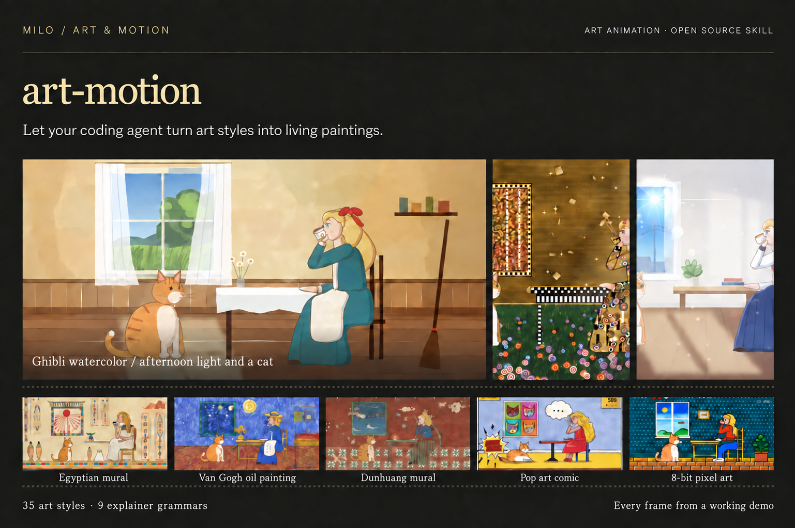
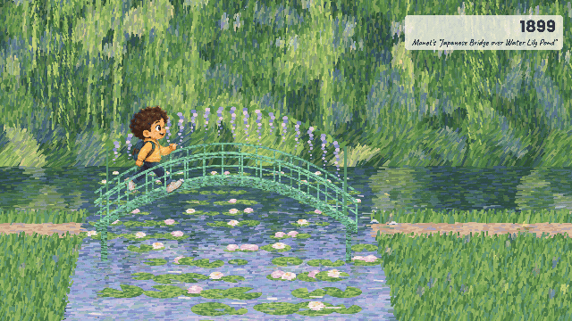
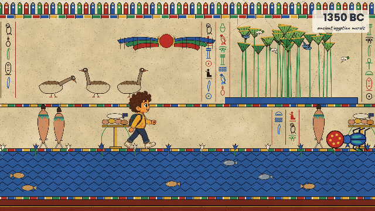
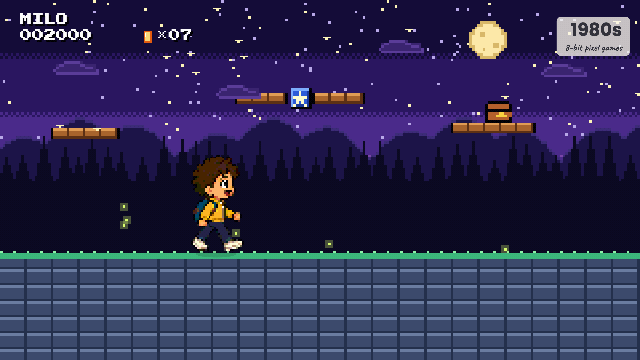
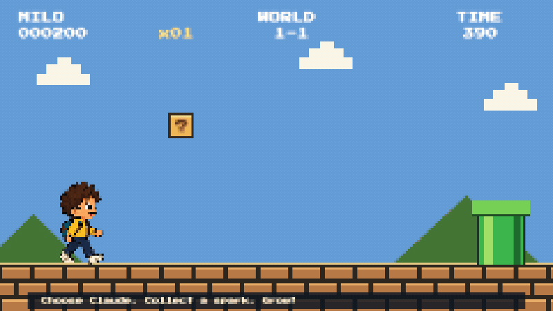
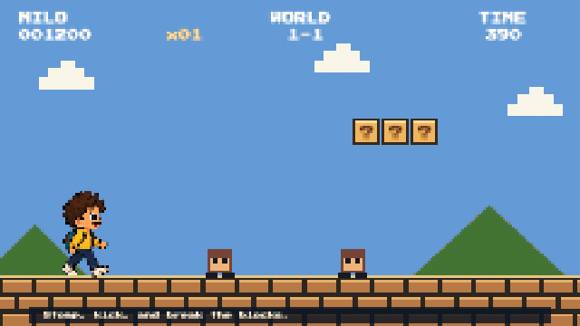
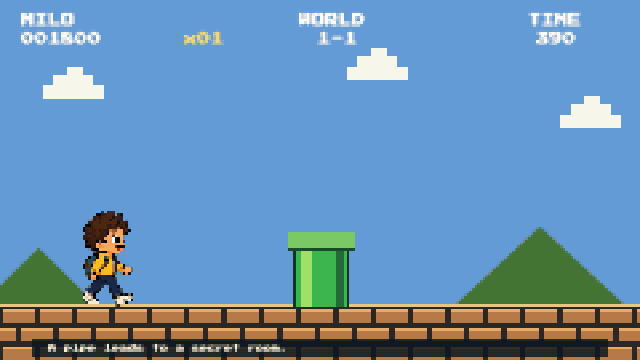
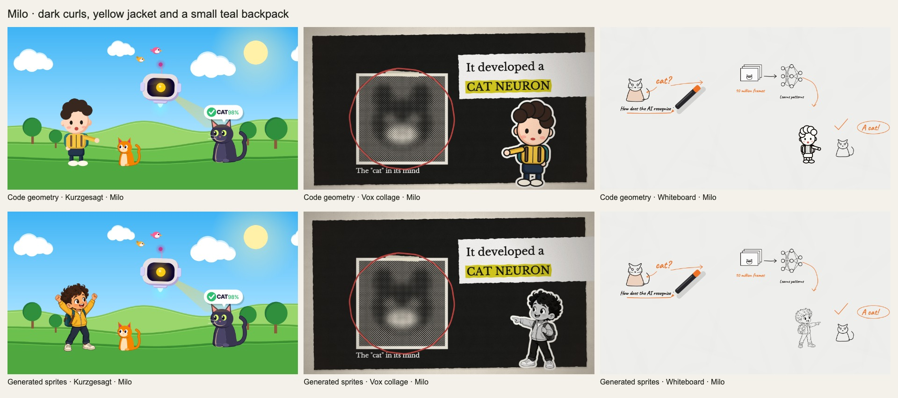
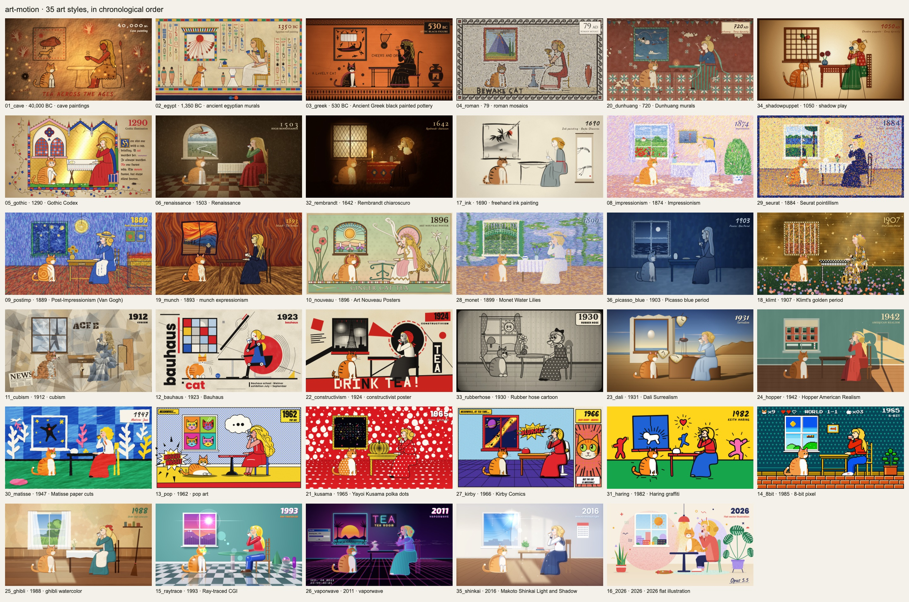

# art-motion

**Turn art styles, ideas and narration into animated scenes.**

art-motion is a skill for coding agents and a portable HTML Canvas animation toolkit. It includes working demos, reusable drawing libraries and guides for building art films, explainers and character animations.

**35 art styles · 9 explainer grammars · 8 configurable clip formats**



[Quick start](#quick-start) · [Meet Milo](#meet-milo) · [Art styles](#art-styles) · [Explainer formats](#explainer-formats) · [Documentation](#documentation)

[Contributing](CONTRIBUTING.md) · [MIT license](LICENSE) · [Security](SECURITY.md) · [Accessibility](ACCESSIBILITY.md)

## Quick start

### Use with your coding agent

Install the skill:

```sh
npx skills add Hostlife22/art-motion
```

Then give your agent a concrete brief. For example:

> Use art-motion to create a 15-second animation of Milo walking through a Monet-inspired garden. Include moving water, a stone-skipping action and a slow camera move.

> Use art-motion to turn this narration into an explainer. Choose a visual format for each shot and leave room for subtitles.

> Use art-motion to break down this reference animation: identify its cuts, motion, transitions and beat grid, then apply those mechanics to a new subject.

The skill guides the agent through scene planning, style selection, frame design, animation and quality checks. Read [SKILL.md](SKILL.md) for the production workflow.

### Run the included demos

You need [uv](https://docs.astral.sh/uv/), FFmpeg on your PATH and Playwright Chromium.

```sh
git clone https://github.com/Hostlife22/art-motion.git
cd art-motion
uv run --with playwright playwright install chromium
```

For an interactive browser preview, start a local server:

```sh
uv run python -m http.server 8000 --bind 127.0.0.1 --directory scripts/engine
```

Open a demo:

| Preview                          | Local URL                                                                           |
| -------------------------------- | ----------------------------------------------------------------------------------- |
| All 35 art styles                | [Style gallery](http://127.0.0.1:8000/index.html?film=gallery)                      |
| Milo's pixel adventure           | [Pixel adventure](http://127.0.0.1:8000/index.html?film=demos/milo_pixel_adventure) |
| Egyptian, Monet and pixel worlds | [Long-scroll film](http://127.0.0.1:8000/index.html?film=demos/long_scroll)         |
| Animated collage explainer       | [Vox demo](http://127.0.0.1:8000/index.html?film=demos/y2_vox)                      |

For your first export, render a Van Gogh-style still or the complete Milo adventure. Run these commands from the repository root:

```sh
uv run --with playwright python scripts/engine/render.py --solo 09_postimp --stills 0.3 --out renders/van-gogh
uv run --with playwright python scripts/engine/render.py --film demos/milo_pixel_adventure --fps 30 --out renders/milo-adventure.mp4
```

The renderer starts its own local server. Stills are saved as PNG; video exports use MP4 by default.

## Meet Milo

Milo is a young traveler with dark brown curls, a yellow jacket and a small teal backpack. His gestures and reactions carry the story while his rendering changes to match each world.

Canvas draws the scenery, props, camera movement and transitions. Milo uses generated sprite frames in the showcase films, with procedural alternatives in the explainer demos.

### A walk through paintings

Milo skips a stone from Monet's Japanese bridge, meets a scarab in an Egyptian mural and hits a coin block in an 8-bit world.



<table>
<tr>
<td width="50%"><br/><strong>Egyptian mural</strong> · Scarab encounter</td>
<td width="50%"><br/><strong>8-bit world</strong> · Coin block</td>
</tr>
</table>

These excerpts share one [long-scroll demo](scripts/engine/demos/long_scroll/). Each world has its own scene file; the camera moves forward and the character changes style at the boundaries.

### A pixel adventure

An 18.5-second demo with a subscription-choice joke, a stomp-and-kick combo and a pipe journey to a coin room. The GIFs below are silent and loop.



<table>
<tr>
<td width="50%"><br/><strong>Stomp, kick, break</strong></td>
<td width="50%"><br/><strong>Through the pipe</strong></td>
</tr>
</table>

[Demo source](scripts/engine/demos/milo_pixel_adventure/) · [Clip timings and rebuild commands](assets/showcase/mario-clips.md)

<details>
<summary>See Milo in three explainer styles</summary>



The top row uses code-drawn geometry; the bottom row uses generated sprites. Both are rendered from the working demos. The [character guide](references/10-characters.md) explains the approaches; [Milo's asset notes](assets/characters/milo/README.md) include his identity, generation prompts and rebuild commands.

</details>

## Art styles

The gallery follows a girl and an orange-and-white cat through 35 interpretations of the same scene. Each interpretation has moving elements and a transition shaped by the next style: swirling brushwork, flowing mosaic colors, ink washes, paper folds and more.



Styles include cave painting, Egyptian murals, Greek ceramics, Roman mosaics, Gothic illumination, Renaissance painting, Impressionism, Bauhaus, Pop Art, pixel art, ink painting, Ghibli-inspired watercolor and many others.

Every style has a [recipe card](references/style-recipes/INDEX.md) and a matching [Canvas scene](scripts/engine/scenes/). Cards record palettes, materials, motion patterns, transitions and known limitations, so you can adapt a style to your own subject.

Render the complete gallery:

```sh
uv run --with playwright python scripts/engine/render.py --film gallery --fps 30 --out renders/gallery.mp4
```

## Explainer formats

A visual grammar defines how a scene presents information: its layout, motion, camera, typography and transitions. Eight formats include a working demo and a JSON-driven clip renderer.

| Format                                                                 | Best suited to                                    | Example specification                                                  |
| ---------------------------------------------------------------------- | ------------------------------------------------- | ---------------------------------------------------------------------- |
| [Kurzgesagt](references/animation-grammars/y1_kurzgesagt.md)           | Science, scale and journeys through nested worlds | [y1_kurzgesagt.json](scripts/engine/examples/y1_kurzgesagt.json)       |
| [Vox](references/animation-grammars/y2_vox.md)                         | Documents, evidence, collage and annotations      | [y2_vox.json](scripts/engine/examples/y2_vox.json)                     |
| [Whiteboard](references/animation-grammars/y3_whiteboard.md)           | Relationships and arguments drawn step by step    | [y3_whiteboard.json](scripts/engine/examples/y3_whiteboard.json)       |
| [Storytime](references/animation-grammars/y4_storytime.md)             | Personal stories, reactions and comic pauses      | [y4_storytime.json](scripts/engine/examples/y4_storytime.json)         |
| [Kinetic typography](references/animation-grammars/y5_kinetic_type.md) | Keywords, titles and animated text                | [y5_kinetic_type.json](scripts/engine/examples/y5_kinetic_type.json)   |
| [3Blue1Brown](references/animation-grammars/t1_3b1b.md)                | Abstract concepts and object transformations      | [t1_3b1b.json](scripts/engine/examples/t1_3b1b.json)                   |
| [Keynote UI](references/animation-grammars/t2_keynote_ui.md)           | Product screens, interface cards and big numbers  | [t2_keynote_ui.json](scripts/engine/examples/t2_keynote_ui.json)       |
| [Finance charts](references/animation-grammars/t3_finance_chart.md)    | Data, trends and focused chart annotations        | [t3_finance_chart.json](scripts/engine/examples/t3_finance_chart.json) |

The ninth grammar, [presenter-led explainers](references/animation-grammars/y6_presenter_explainer.md), provides a guide and narrated-film reference code. It requires your own presenter frames and audio.

To export a configurable clip, edit an example JSON and render it:

```sh
uv run --with playwright python scripts/engine/render.py --spec scripts/engine/examples/t3_finance_chart.json --out renders/finance-chart.mp4
```

Specifications control duration, dimensions, frame rate, content and timed cues. Landscape and portrait output are supported. Clips render exactly `round(duration × fps)` frames; add `--alpha` and use a `.mov` output path for transparent ProRes 4444.

See the [clip contract and grammar guide](references/09-video-animation-grammars.md) for the full specification.

## Build your own film

Copy `scripts/engine/` into your project. Edit `eras.js` to define the sequence, then add or adapt `scenes/<id>.js`. Shared libraries provide brushes, textures, rigs, cameras, charts, typography and transitions.

For narration, start with a shot list and timed cues. Choose a visual grammar for each explanation, design the frames, then animate and export the visual track. Add a soundtrack to a film with `render.py --audio music.wav`.

Before delivery, run the quality checks:

```sh
uv run scripts/qa.py --project scripts/engine --film demos/milo_pixel_adventure --out renders/qa-milo
uv run scripts/qa.py --spec scripts/engine/examples/t3_finance_chart.json --out renders/qa-chart
```

QA reports determinism, render cost, motion, smoothness and text framing. Review the resulting frames and film alongside the measurements; deliberate pauses and stylistic flicker need visual judgment. For films with light, untextured backgrounds, `scripts/subzone_gate.py` checks whether graphics enter the subtitle area.

## Documentation

| Start here                                                                  | Contents                                                 |
| --------------------------------------------------------------------------- | -------------------------------------------------------- |
| [Skill instructions](SKILL.md)                                              | Task routing and production workflow                     |
| [Style index](references/style-recipes/INDEX.md)                            | All 35 styles, quality notes and limitations             |
| [Animation breakdown](references/01-breakdown.md)                           | Cuts, beat grids, keyframes and motion maps              |
| [Frame-first approaches](references/03-frame-first-four-approaches.md)      | Design a frame before committing to animation            |
| [Code drawing](references/04-code-drawing.md)                               | Layers, renderers and reusable drawing techniques        |
| [Rhythm and music](references/05-rhythm-and-music.md)                       | Beat synchronization and an original synthesized score   |
| [Narration planning](references/06-narration-driven-art-shorts.md)          | Shot lists, staging and timed visual tracks              |
| [Characters](references/10-characters.md)                                   | Generated frames, procedural rigs and compositing        |
| [Long-scroll films](references/11-long-scroll-films.md)                     | Connected worlds and forward camera movement             |
| [Narrated-film references](scripts/engine/reference_films/spacex/README.md) | Full-film code snapshots and required external assets    |
| [Asset rebuilding](assets/localization/README.md)                           | English captions, image generation and overview builders |

```text
art-motion/
├── SKILL.md                    # Instructions for coding agents
├── references/                 # Methods, style recipes and explainer guides
├── assets/                     # Showcase GIFs, gallery sheets and Milo atlases
└── scripts/
    ├── engine/                 # Canvas engine, scenes, demos, clips and renderer
    ├── analyze/breakdown.py     # Reference-video analysis
    ├── audio/                  # Original synthesized soundtrack template
    ├── qa.py                   # Animation and text-framing checks
    ├── build_overviews.py      # Gallery and demo overview images
    ├── build_milo_showcase.py  # Showcase GIF renderer
    └── install_milo_sprites.py # Sprite extraction and foot-anchor metadata
```

## Contributing

Help improve scenes, explainer formats, documentation or accessibility. See [CONTRIBUTING.md](CONTRIBUTING.md) for setup, project conventions and validation before a pull request.

GitHub Actions validates changes and publishes a release when a tag is pushed. Releases include ZIP and tar.gz packages with SHA-256 checksums. See the [release instructions](CONTRIBUTING.md#releases).

## MIT license

art-motion is maintained by [Hostlife22](https://github.com/Hostlife22) and distributed under the [MIT license](LICENSE). Retained upstream code is covered by [third-party notices](THIRD_PARTY_NOTICES.md). Bundled fonts retain their [own license notices](scripts/engine/lib/fonts/LICENSES.md); the reference-film documentation includes a separate [third-party stroke-data notice](scripts/engine/reference_films/spacex/README.md#third-party-stroke-data).

## Security

See [SECURITY.md](SECURITY.md) for supported code, private vulnerability reporting and the local toolkit's trust model.

## Accessibility

See [ACCESSIBILITY.md](ACCESSIBILITY.md) for current support, known limitations, still-viewing options and contribution guidance.
